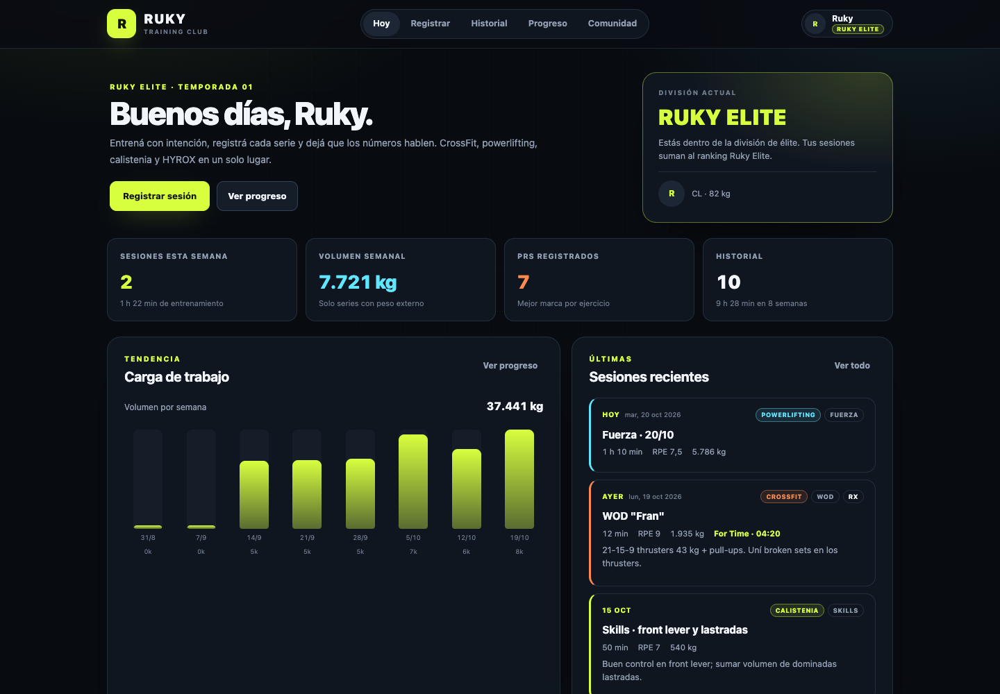

# RUKY

Entrenamiento y competencia para **CrossFit, powerlifting, calistenia y HYROX**: registrá tus sesiones,
mirá tu progreso, competí por ranking y entrá a la división **Ruky Elite**.



<sub>Vista móvil: [captura responsive](docs/captura-mobile.png) · Competencias: [captura Strong Fit](docs/captura-compete.png) · Acceso: [captura login](docs/captura-auth.png).</sub>

## Qué está implementado

- **Dashboard semanal**: sesiones, volumen, PRs, minutos, chart de 8 semanas, sesiones recientes y
  mini ranking de la comunidad.
- **Registro de sesiones**: fuerza, WOD, simulación HYROX, skills, cardio y mixto; series con
  ejercicio, reps, kg, segundos (holds) y RPE. Fecha, duración, notas y división.
- **Historial**: filtros por disciplina, series desplegables, borrado con confirmación.
- **Progreso**: PRs por ejercicio (peso, reps o segundos), volumen semanal y mezcla de disciplinas.
- **Comunidad**: ranking por volumen, sesiones o minutos; períodos de 4/8/12 semanas; filtro
  **Ruky Elite**.
- **Auth JWT + RLS**: registro/login con BCrypt, tokens HS256 y aislamiento por atleta en PostgreSQL.
  El ranking comunitario usa una vista agregada, sin exponer sesiones ajenas.
- **Competencias Strong Fit**: competencia en vivo con 4 pruebas, inscripción por división (Ruky
  Elite / RX), carga y edición de resultados, puntaje por posición y leaderboard por división.
- **Backend Spring Boot 3.3 / Java 17**: contrato `/api`, validación, errores uniformes, cálculos de
  volumen/PR/ranking/puntaje, 47 tests.
- **PostgREST + PostgreSQL 16**: 10 tablas, roles `app_user`/`app_service`, RLS, catálogo de 34
  ejercicios, RPC atómica para sesiones + series y datos demo de 4 atletas.
- **Docker Compose**: desarrollo y stack completo con Nginx (`:8081`).
- **Agentes DSH**: 6 skills + 5 briefs para seguir construyendo sin romper el dominio.

## Qué falta (explícito)

- **Cierre de competencias**: no hay admin que valide resultados ni cierre una competencia; el
  atleta puede editar su marca mientras esté `LIVE`.
- **Criterios Ruky Elite**: la división existe (`athletes.tier`); los estándares son de referencia,
  no un sistema de clasificación.
- **Sesiones JWT**: 12 h de vigencia, sin refresh ni revocación.
- Migraciones formales (hoy scripts de init), CI y E2E versionado.

## Arquitectura

```text
┌─────────────────┐      /api       ┌──────────────────┐      HTTP       ┌────────────┐      ┌────────────┐
│ React 19 + TS   │ ──────────────▶ │ Spring Boot BFF  │ ──────────────▶ │ PostgREST  │ ───▶ │ PostgreSQL │
│ :5173 / :8081   │                 │ :8080            │                 │ :3000      │      │ :5432      │
└─────────────────┘                 └──────────────────┘                 └────────────┘      └────────────┘
        UI                          contrato + stats                    REST declarativo      fuente de verdad
```

- El navegador **solo** conoce `/api`; PostgREST queda en la red privada.
- Spring valida, calcula volumen/PRs/ranking y orquesta la creación de sesiones.
- La creación de sesión + series usa `api.create_session(jsonb)` vía RPC para ser atómica.
- Decisiones y consecuencias: [`docs/decisiones.md`](docs/decisiones.md).

## Requisitos

| Herramienta | Versión | Nota |
|---|---|---|
| Docker + Compose | reciente | Postgres y PostgREST |
| Java | 17+ | backend |
| Node.js | 20+ | Vite 6 |
| Maven | — | incluimos `backend/mvnw` |

## Arranque rápido (3 terminales)

```bash
cp .env.example .env      # opcional

make up                   # Postgres + PostgREST (espera healthy)
make install              # deps frontend (una vez)

# Terminal A
make backend              # http://localhost:8080

# Terminal B
make frontend             # http://localhost:5173
```

Abrí **http://localhost:5173** e ingresá con la cuenta demo:

```text
ruky@ruky.demo · ruky1234
```

También podés crear una cuenta nueva desde "Crear cuenta". La primera vez `./mvnw` descarga Maven y
dependencias.

Verificación:

```bash
make test     # 47 tests backend + typecheck/build frontend
make smoke    # crea una sesión de 500 kg, la lista y la borra
```

### Todo en Docker

```bash
make full-up      # http://localhost:8081
make full-down
```

Nginx sirve la SPA y hace proxy de `/api`; Postgres y PostgREST no se publican.

## Cómo se usa

1. **Hoy**: resumen semanal, evolución y accesos rápidos.
2. **Registrar**: elegí disciplina (CrossFit, Powerlifting, Calistenia, HYROX). El tipo de sesión y
   el catálogo de ejercicios se adaptan.
   - Fuerza/Skills: agregá series con reps, kg o segundos.
   - WOD: formato (AMRAP, EMOM, For Time, Intervalos), score y división.
   - HYROX: tiempo total y división (Open, Pro, Dobles, Relay).
3. **Historial**: filtrá por disciplina y desplegá las series de cada sesión.
4. **Progreso**: PRs, volumen semanal y distribución de la carga.
5. **Competir**: inscribite en la división Ruky Elite o RX, cargá tus marcas en cada prueba y seguí
   el leaderboard. El puntaje es por posición y se recalcula en vivo.
6. **Comunidad**: cambiá métrica, período y división. **Ruky Elite** filtra solo atletas `ELITE`.

### Datos demo

Cuentas (contraseña `ruky1234`): `ruky@ruky.demo` (Elite), `vale@ruky.demo` (Elite),
`nacho@ruky.demo` (Open), `sofi@ruky.demo` (Open).
- 10 sesiones de Ruky distribuidas en 6 semanas (fuerza, Fran, Grace, HYROX Open, skills).
- 34 ejercicios de las cuatro disciplinas.
- Competencia `strong-fit-ruky-1`: 4 pruebas, 2 divisiones y 16 resultados cargados.

Para volver a empezar: `make db-reset` (destructivo, borra el volumen).

## API

Base: `http://localhost:8080/api`. Todos los endpoints salvo `/api/auth/**` requieren
`Authorization: Bearer <token>`.

| Método | Ruta | Descripción |
|---|---|---|
| `POST` | `/api/auth/register` | Crea atleta + credenciales (201) |
| `POST` | `/api/auth/login` | Devuelve JWT + atleta |
| `GET` | `/api/me` | Atleta autenticado |
| `GET` | `/api/athletes` | Comunidad |
| `GET` | `/api/exercises?discipline=POWERLIFTING` | Catálogo |
| `GET` | `/api/sessions?size=20&discipline=CROSSFIT` | Historial con series |
| `GET` | `/api/sessions/{id}` | Detalle |
| `POST` | `/api/sessions` | Crea sesión + series |
| `DELETE` | `/api/sessions/{id}` | Borra |
| `GET` | `/api/stats?weeks=8` | Totales, semanal, PRs, disciplinas |
| `GET` | `/api/competitions` | Competencias |
| `GET` | `/api/competitions/{slug}` | Detalle + inscripción propia + leaderboards |
| `POST` | `/api/competitions/{slug}/register` | Inscribirse / cambiar de división |
| `DELETE` | `/api/competitions/{slug}/register` | Darse de baja |
| `POST` | `/api/competitions/{slug}/events/{id}/result` | Cargar/actualizar resultado |
| `GET` | `/api/leaderboard?weeks=4&metric=VOLUME&tier=ELITE` | Ranking |

```bash
# Login y token
TOKEN=$(curl -s -X POST http://localhost:8080/api/auth/login \
  -H 'Content-Type: application/json' \
  -d '{"identifier":"ruky@ruky.demo","password":"ruky1234"}' \
  | python3 -c 'import json,sys; print(json.load(sys.stdin)["token"])')

# Historial
curl -s -H "Authorization: Bearer $TOKEN" 'http://localhost:8080/api/sessions?size=2' | python3 -m json.tool

# Crear una sesión de fuerza
curl -s -X POST http://localhost:8080/api/sessions \
  -H "Authorization: Bearer $TOKEN" \
  -H 'Content-Type: application/json' \
  -d '{
    "performedOn": "2026-10-20",
    "discipline": "POWERLIFTING",
    "sessionType": "STRENGTH",
    "title": "Fuerza · sentadilla",
    "durationMin": 60,
    "rpe": 8,
    "entries": [
      {"movement": "Back Squat", "setIndex": 1, "reps": 5, "weightKg": 100}
    ]
  }'

# Stats y ranking
curl -s -H "Authorization: Bearer $TOKEN" 'http://localhost:8080/api/stats?weeks=8'
curl -s -H "Authorization: Bearer $TOKEN" 'http://localhost:8080/api/leaderboard?weeks=4&metric=VOLUME&tier=ELITE'

# Competencia: detalle + leaderboard
curl -s -H "Authorization: Bearer $TOKEN" 'http://localhost:8080/api/competitions/strong-fit-ruky-1'

# Cargar un resultado (atleta demo inscripto)
curl -s -X POST 'http://localhost:8080/api/competitions/strong-fit-ruky-1/events/<eventId>/result' \
  -H "Authorization: Bearer $TOKEN" \
  -H 'Content-Type: application/json' -d '{"rawScore":250}'
```

Errores uniformes:

```json
{
  "timestamp": "2026-10-20T01:20:47-03:00",
  "status": 400,
  "error": "Bad Request",
  "message": "Un WOD necesita formato y resultado",
  "path": "/api/sessions"
}
```

## Datos y PostgREST

- Esquema `api`: `athletes`, `exercises`, `training_sessions`, `session_entries` y las 5 tablas de
  competencia (`competitions`, `competition_divisions`, `competition_events`,
  `competition_registrations`, `competition_results`).
- **Volumen** = Σ `reps × weight_kg`; las series de peso corporal no suman.
- **PRs** solo de sesiones `STRENGTH` y `SKILL`; holds usan segundos.
- **Ranking** por volumen/sesiones/minutos, agregado en backend sobre las sesiones del período.
- **Competencias**: puntos por prueba = `(participantes - puesto + 1) × 10`; resultado ausente = 0.
  Desempate por cantidad de primeros puestos. Se calcula en backend, no se persiste.
- Roles: `authenticator` (login), `app_user` (JWT, RLS), `app_service` (solo backend, BYPASSRLS).
  `web_anon` no tiene acceso a tablas.
- **RLS**: sesiones y series solo del atleta autenticado; perfiles y resultados de competencia
  visibles para la comunidad; leaderboard vía `athlete_weekly_activity`.
- `app_user` no puede leer `athlete_credentials`; el hash BCrypt solo lo ve el backend.

```bash
# Consulta directa (debug)
curl -s 'http://localhost:3000/training_sessions?select=*,session_entries(*)&limit=1' | python3 -m json.tool

# SQL
docker compose exec db psql -U ruky -d ruky -c 'select count(*) from api.training_sessions;'
```

## Agentes de programación (DSH)

- [`AGENTS.md`](AGENTS.md): reglas, contrato, cálculos, quality gates y deuda.
- [`.dsh/skills/`](.dsh/skills): 6 skills que DSH descubre automáticamente.
- [`.dsh/agents/`](.dsh/agents): 5 briefs para `subagent`, con alcance y reporte.

| Skill | Cuándo |
|---|---|
| `arquitectura-fullstack` | diseñar una funcionalidad o cambiar el contrato |
| `backend-spring-boot` | endpoints, RPC, stats, tests Java |
| `frontend-react-ts` | páginas, formulario de sesión, estilos |
| `datos-postgrest` | esquema, RPC, roles, consultas |
| `verificacion-fullstack` | smoke, E2E, diagnóstico por capa |
| `revision-codigo` | review P0/P1/P2 antes de cerrar |

Ejemplo de delegación:

```text
subagent(
  description: "Backend: PRs por tiempo",
  prompt: "Leé .dsh/agents/backend-dev.md y .dsh/skills/backend-spring-boot/SKILL.md.
           Tarea: agregar el mejor tiempo por ejercicio a /api/stats, con tests.
           No toques frontend. Reportá comandos y resultado."
)
```

Flujo recomendado: `arquitectura-fullstack` → `data-dev` → `backend-dev` → `frontend-dev` →
`integrator` → `reviewer`.

> DSH detecta `.dsh/skills` porque el repo tiene `.git` en la raíz. Si ya tenías la sesión abierta
> antes de crear el repo, abrí una sesión nueva o ejecutá `touch .dsh/skills/*/SKILL.md`.

## Estructura

```text
.
├── AGENTS.md
├── Makefile
├── compose.yaml / compose.full.yaml
├── db/init/
│   ├── 001_roles.sql
│   ├── 002_schema.sql
│   ├── 003_exercises.sql
│   ├── 004_demo_data.sql
│   ├── 005_functions.sql
│   ├── 006_competitions.sql
│   ├── 007_competition_demo.sql
│   └── 008_auth.sql
├── backend/
│   ├── mvnw
│   └── src/main/java/com/ruky/training/
│       ├── config/      RestClient, JWT y seguridad
│       ├── domain/      Atletas, sesiones, competencias
│       ├── postgrest/   Repositorios, RPC y upserts
│       ├── security/    JwtService, filtro y contexto
│       ├── service/     Auth, sesiones, stats, leaderboard, scoring
│       ├── web/         Controllers y DTOs
│       └── error/       ApiError + handler
├── frontend/
│   ├── src/api/         Tipos y cliente
│   ├── src/hooks/       useRukyData, useLeaderboard, useCompetition
│   ├── src/components/  Header, SessionForm, SessionCard, chart
│   └── src/pages/       Dashboard, History, Progress, Compete, Community
├── scripts/             smoke.sh, dev.sh
├── docs/                Capturas y ADR
└── .dsh/                Skills y briefs
```

## Seguridad

> **JWT + RLS activos.** Las cuentas demo usan la contraseña `ruky1234` y el secreto JWT de
> desarrollo está versionado en `.env.example`/compose. No uses esos valores con datos reales.

Antes de producción:

- `PGRST_JWT_SECRET` real (≥32 caracteres) y rotación; evaluar refresh tokens y revocación.
- HTTPS, rate limiting, backups y observabilidad.
- Revisar políticas RLS con tests de aislamiento entre cuentas.
- Postgres/PostgREST en red privada; el backend es el único cliente.

## Roadmap

1. **Cierre y validación de competencias**: admin que confirme resultados, cierre eventos y
   publique el ranking final.
2. **Ruky Elite**: benchmarks oficiales y flujo de clasificación.
3. **Progreso avanzado**: 1RM estimado, mejores tiempos, comparación por disciplina.
4. Migraciones Flyway, CI y E2E Playwright versionado.

## Troubleshooting

| Problema | Solución |
|---|---|
| `port is already allocated` | Liberá `5432`, `3000`, `8080` u `8081` |
| PostgREST 401/403 | Roles/grants no aplicados → `make db-reset` |
| 502 al crear sesión | RPC sin `payload`, sin reload o PostgREST caído |
| `PGRST204 session_entries` | No uses nested insert; la creación va por RPC |
| PR muestra “0 reps” | Revisá `bestSeconds`/`bestReps` en `/api/stats` |
| Cambios de esquema no aparecen | `make db-reset` |
| CORS 403 | Agregá el origen a `CORS_ALLOWED_ORIGINS` |
| `npm install` con `EPERM` en `_cacache` | `npm install --cache /tmp/npm-cache` |
| Skills no aparecen | Sesión nueva o `touch .dsh/skills/*/SKILL.md` |

---

RUKY · entrená con intención, competí con datos.
